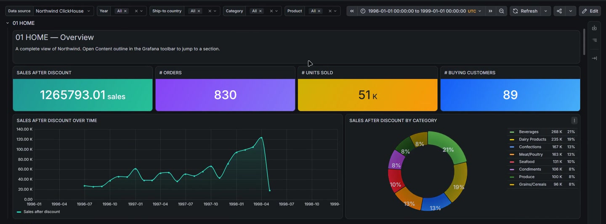
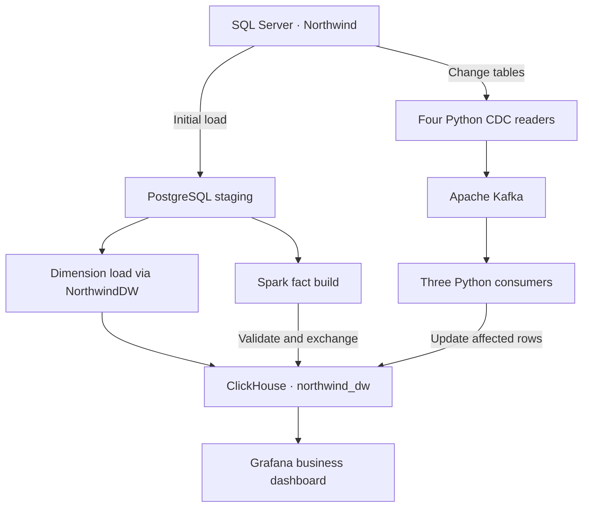
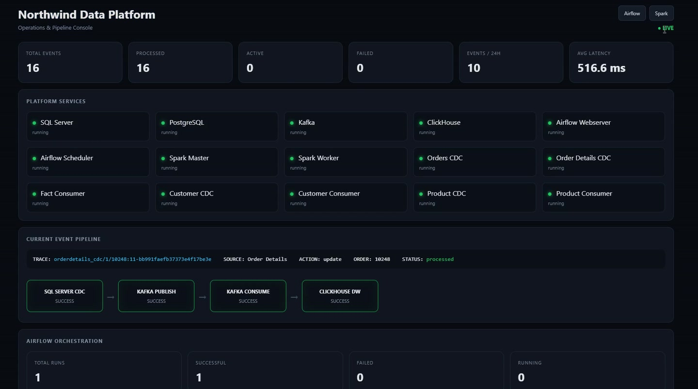
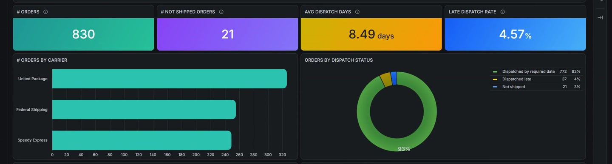

# Northwind Near-Real-Time Data Platform

Follow an order from SQL Server to the sales dashboard in Grafana. Airflow and Spark build the initial warehouse. After that load, SQL Server CDC, Kafka and Python consumers keep customer, product and order data up to date in ClickHouse.

In a recorded run, order 10248 contained 12 units of product 11 at 14.00 each with zero discount. Increasing the quantity to 13 moved net sales from **1,265,793.01** to **1,265,807.01**. Restoring the quantity brought the warehouse total back to its starting value. The screenshots on this page come from that project recording.



[Architecture](#architecture) · [Technology stack](#technology-stack) · [Warehouse model](#warehouse-model) · [Observability](#observability) · [Getting started](#getting-started) · [Verification](#verification)

## Architecture



### Initial load and Airflow workflow

The launcher imports the pinned Microsoft Northwind sample, sets up staging and CDC, and loads the dimensions. The six tasks in the [northwind_etl DAG](airflow/dags/northwind_supplier_etl.py) then check batch readiness, validate the ClickHouse dimensions, load staged order lines, validate staging, run Spark and validate the resulting facts.

[Spark](scripts/spark_factorders_job.py) writes to a separate build table. It checks row counts and amounts before exchanging that table with `factorders`. The launcher starts the live consumers after the initial load passes its checks. The DAG guards against a concurrent batch rebuild while consumers are active.

### CDC and incremental processing

| SQL Server change | Kafka topic | Consumer | ClickHouse table |
| --- | --- | --- | --- |
| Customers | `dimcustomer_changes` | `customer_consumer` | `dimcustomer` |
| Products | `dimproducts_changes` | `product_consumer` | `dimproducts` |
| Orders | `orders_changes` | `factorders_consumer` | `factorders` |
| Order Details | `orderdetails_changes` | `factorders_consumer` | `factorders` |

Each reader resumes from its SQL Server log sequence number (LSN) in PostgreSQL and advances its checkpoint after Kafka acknowledges publication. Each consumer commits its Kafka offset after its handler succeeds. Customer and product changes maintain dimension history. An order event carries identifying keys. The [fact consumer](scripts/factorders_consumer.py) rereads the current source order and replaces that order's fact rows. Reports may briefly omit that order between the delete and insert.

## Technology stack

| Component | Work performed | Local interface |
| --- | --- | --- |
| SQL Server 2022 | Northwind OLTP, CDC and NorthwindDW dimension preparation | `127.0.0.1:14332` |
| PostgreSQL 16 | Staging, CDC checkpoints, event traces and alerts | `127.0.0.1:5434` |
| Apache Kafka 3.9.2 | Change events and consumer offsets | `127.0.0.1:9092` |
| Python | CDC readers, consumers, reconciliation and notifications | Runs inside containers |
| Apache Airflow 2.10.5 | Batch orchestration and task failure callbacks | [Airflow](http://127.0.0.1:8080/) |
| Apache Spark 3.5.8 | Initial fact transformations and warehouse validation | [Spark UI](http://127.0.0.1:8081/) |
| ClickHouse 24.8 | Dimensional warehouse and analytical queries | HTTP on `127.0.0.1:8125` |
| Grafana 13.2.1 | Business reporting through the ClickHouse datasource | [Grafana](http://127.0.0.1:3000/) |
| FastAPI | Operations Console, event tracking and service logs | [Ops console](http://127.0.0.1:8090/) |

## Warehouse model

`factorders` stores one row per order and product, including quantity, unit price, gross amount, discount amount and net amount. Its dimension keys support analysis by product, customer, employee, carrier, geography and date.

| Dimension | Use |
| --- | --- |
| `dimcustomer`, `dimproducts` | Customer and product attributes with processing-time history |
| `dimemployee`, `dimshipper` | Employee sales contribution and carrier comparisons |
| `dimsupplier`, `dimgeography`, `dimdate` | Supplier, location and calendar lookups |

The [dimension definitions](scripts/create_clickhouse_dimensions.py) and [fact definition](scripts/create_clickhouse_factorders.py) contain the column types and sort keys.

## Observability

The Operations Console shows service health, Airflow run summaries, recent CDC events, pipeline stages, alerts and selected container logs. Follow a trace ID through `CDC_CAPTURE`, `KAFKA_PUBLISH`, `KAFKA_CONSUME` and `CLICKHOUSE_WRITE`. Kafka topic, partition and offset identify the broker record. The [Ops schema](sql/ops.sql) defines the event history, trace view and metrics.



Sunway SMS is optional. Task failures are recorded in `ops.alerts`. A separate monitor observes Airflow scheduler and webserver transitions and records its notification outcomes in its logs. A provider message ID confirms acceptance. Handset receipt is checked separately.

## Grafana dashboard

The [original Northwind dashboard](Grafana/Northwind.json) has six sections on one page. Year, Ship-to country, Category and Product are shared filters. Use **Content outline** to jump between sections.

| Section | Example business question |
| --- | --- |
| HOME | What are net sales, order count, units sold and buying customers in the selection? |
| SALES | How do monthly sales, order value and discounts vary by destination? |
| PRODUCTS | Which products contribute the most sales or units? |
| CUSTOMERS | Who buys repeatedly and which customers account for the most sales? |
| EMPLOYEES | How do sales and order counts vary by employee? |
| SHIPPING | How long does dispatch take and which carriers handle the most orders? |



The shipping views use dispatch dates. The historical UTC range for the sample is **1996-01-01 through 1999-01-01**.

## Repository layout

| Location | Contents |
| --- | --- |
| [airflow/dags](airflow/dags) | Airflow batch workflow |
| [scripts](scripts) | Staging, dimension loaders, CDC readers, consumers, Spark job and checks |
| [scripts/common](scripts/common) | Connections, checkpointing, event tracking and alert handling |
| [sql](sql) | Staging, relational warehouse and operations schemas |
| [spark](spark) | Spark image and pinned Python requirements |
| [ops-console](ops-console) | Operations Console and authenticated Spark UI proxy |
| [Grafana](Grafana) | Dashboard JSON, datasource provisioning and optional Compose project |
| [docs/images](docs/images) | Screenshots from the running project |
| [tests](tests) and [.github/workflows](.github/workflows) | Unit tests and GitHub Actions |
| [classic.py](classic.py) and [docker-compose.yml](docker-compose.yml) | Startup, service lifecycle and local network configuration |

## Getting started

### 1. Check the host

Use Linux x86-64 or WSL2 Ubuntu, Python 3.10+ and Docker with a Compose plugin that supports additional build contexts and health waits. In Docker Desktop enable WSL integration for the distribution holding the checkout. Run these commands from the repository root.

```bash
docker version
docker compose version
python3 classic.py ports
```

Docker should report both Client and Server. Review the port preview before startup. The launcher can move a conflicting service in another editable local Compose project to a free port and recreate that service. It saves the previous configuration under `.runtime/port-moves`.

### 2. Start the stack and verify the load

```bash
python3 classic.py up
python3 classic.py check
```

First startup generates a private `.env`, downloads pinned wheels and JDBC drivers, checks their SHA-256 hashes and initializes the databases. Keep source writes paused during the initial load. Allow network access to PyPI, Maven Central, the image registries, package mirrors and Microsoft's sample. To prefetch the wheel and JDBC files separately, run `python3 build_inputs.py`.

Keep each installation's private `.env` with its persistent volumes. The local interfaces use `admin / admin` at first setup. Internal service credentials are generated separately. Use a trusted local machine because selected services have Docker socket access.

### 3. Open Grafana

On a fresh host, start the optional Grafana instance after the core stack is up.

```bash
docker compose --env-file .env -f Grafana/docker-compose.yml up -d
```

Open Grafana and choose **Dashboards → New → Import**. Upload `Grafana/Northwind.json`. The provisioned datasource matches the UID in the original export. Set the historical range above and start with all four filters at **All**.

If you already run Grafana, reuse that instance and connect it to `northwind_classic_default`. For its Northwind ClickHouse datasource choose HTTP, host `northwind_classic_northwind_clickhouse`, internal port `8123` and database `northwind_dw`.

### 4. Enable SMS if needed

After active jobs finish, run `python3 classic.py sms` and enter your own Sunway credentials, sender and recipient. Apply the settings with `python3 classic.py up --no-build`. Activation can send real service-start notifications. Sending is disabled by default.

## Verification

[The reconciliation check](scripts/check.py) compares distinct orders, fact rows, gross sales, discounts and net sales between SQL Server and ClickHouse. It also detects duplicate order/product facts and checks current customer and product counts. In the recorded restored sample it reported **830 orders, 2,155 fact rows and zero duplicate facts**.

| Command | Purpose |
| --- | --- |
| `python3 classic.py status` | Inspect containers and published ports |
| `python3 classic.py check` | Reconcile source and warehouse after consumers catch up |
| `python3 classic.py up --no-build` | Start again using existing images |
| `python3 classic.py stop-job northwind_etl` | Request a controlled stop of the running batch |
| `python3 classic.py stop` | Stop the core stack and retain volumes |

If CDC stalls, check SQL Server Agent and `cdc.Northwind_capture`, then inspect the reader checkpoint and consumer lag. The [GitHub Actions workflow](.github/workflows/checks.yml) verifies the pinned build inputs and runs the startup, SMS and monitor unit tests.
